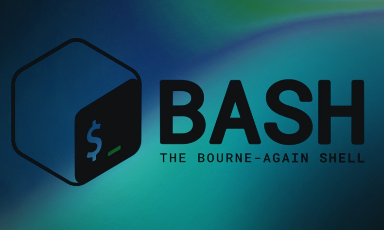

# Bash Operations Reference



A curated collection of Bash examples for database backup and transfer, Azure
and AWS operations, security checks, Docker entrypoints, and small repository
utilities.

## Publishing and privacy

The scripts are templates, not a ready-to-run configuration for a particular
cloud account. Account IDs, domains, hosts, database names, usernames, resource
names, local paths, and customer-specific review content have been removed from
the repository. Cloud scripts require those values through environment
variables or command-line arguments.

Before publishing or running a script:

1. Review the script and its folder README.
2. Provide only the minimum required credentials through your approved secret
   manager or an untracked local environment file. Never put passwords,
   access keys, private keys, tokens, dumps, or cloud evidence in Git.
3. Check the target account and region. Scripts that create, migrate, restore,
   or delete resources can have significant impact.
4. Review generated reports and logs before sharing them; cloud outputs may
   contain live identifiers even when the script source does not.

The `.gitignore` excludes common secrets, database dumps, and generated reports.
It is a safety net, not a substitute for reviewing `git status` before pushing.

## Contents

| Folder | Purpose |
| --- | --- |
| [00-linux-admin](./00-linux-admin/) | Log rotation, rsync backup, and host monitoring |
| [01-aws-backups](./01-aws-backups/) | RDS snapshots and logical dumps |
| [02-database-restore-transfer](./02-database-restore-transfer/) | Database dump validation, transfer, and restore |
| [03-azure-cost-infrastructure](./03-azure-cost-infrastructure/) | Cost reports and jump VM provisioning |
| [04-database-and-dns-migrations](./04-database-and-dns-migrations/) | Database refresh and DNS migration |
| [05-security](./05-security/) | Dependency migration and Trivy helpers |
| [06-residency-verification](./06-residency-verification/) | Read-only location checks and evidence collection |
| [07-docker-cicd](./07-docker-cicd/) | Spring datasource entrypoint variants |
| [08-knowledge-base](./08-knowledge-base/) | Resumable chunked backup upload |
| [09-utilities](./09-utilities/) | Syntax check, file organization, review, and deletion helpers |

## Shell syntax check

On a Bash-capable system, run:

```bash
bash 09-utilities/lint-shell-syntax.sh
```

This only checks shell syntax; it does not connect to cloud accounts or verify
that remote services, permissions, or database schemas are available.
